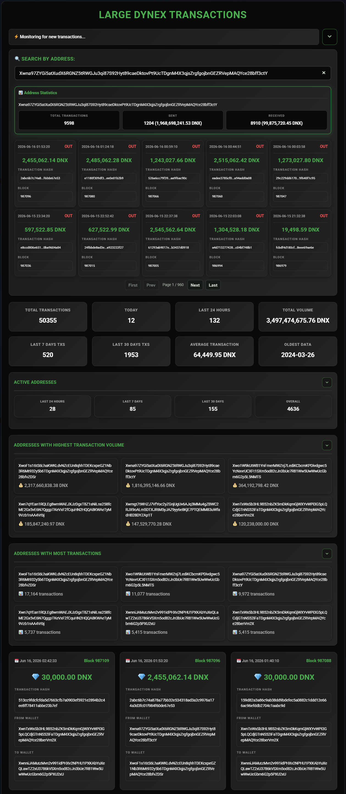
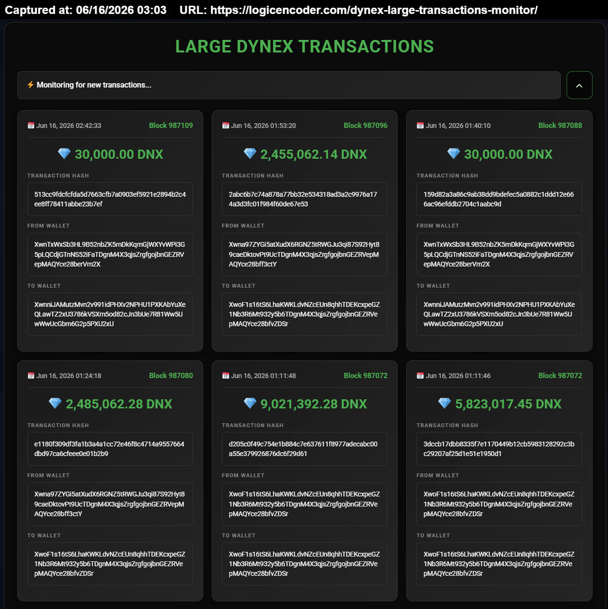
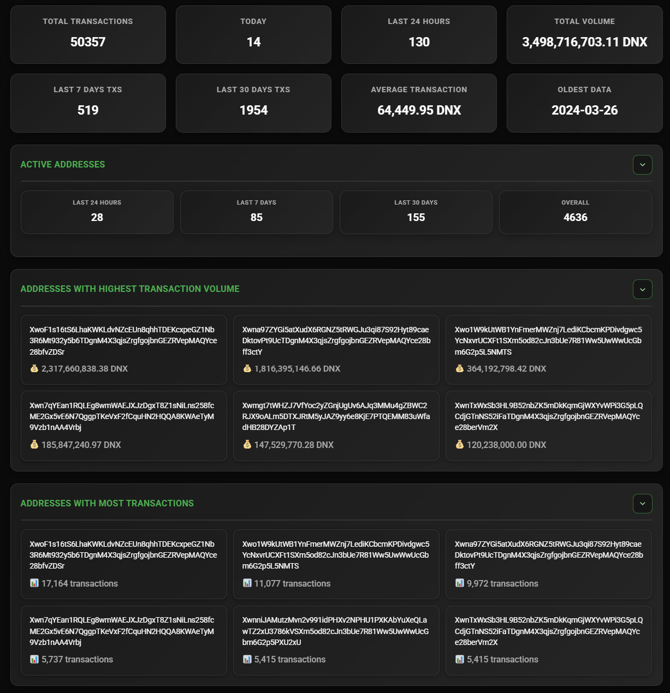
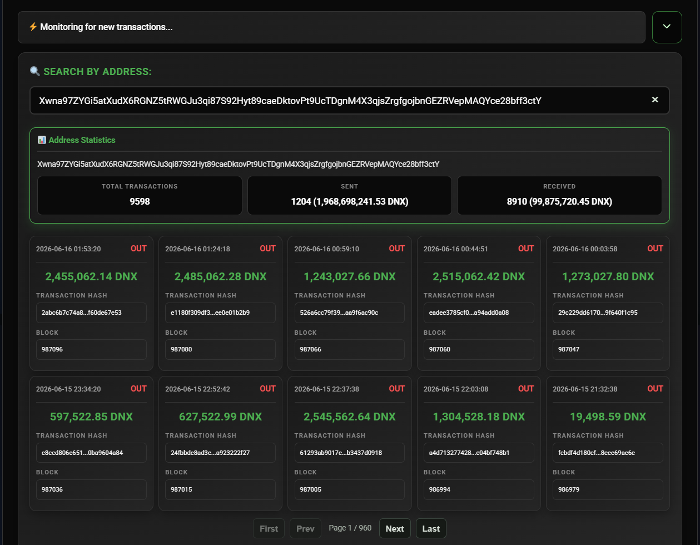
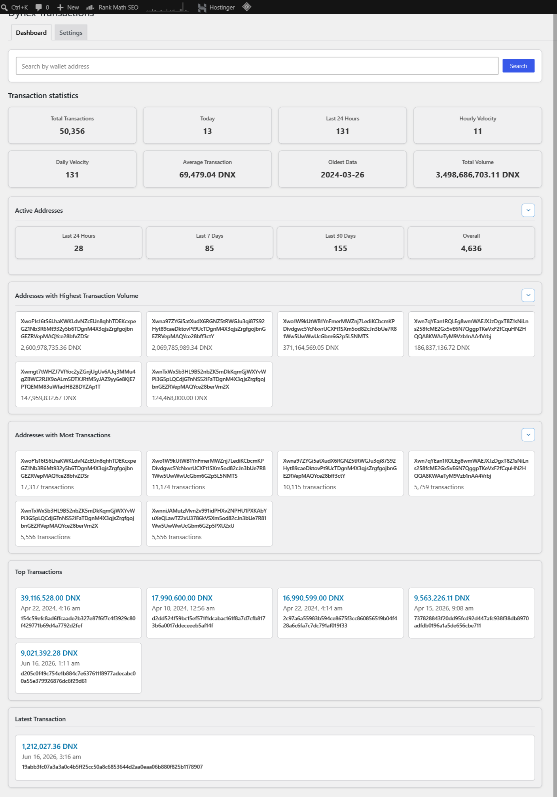
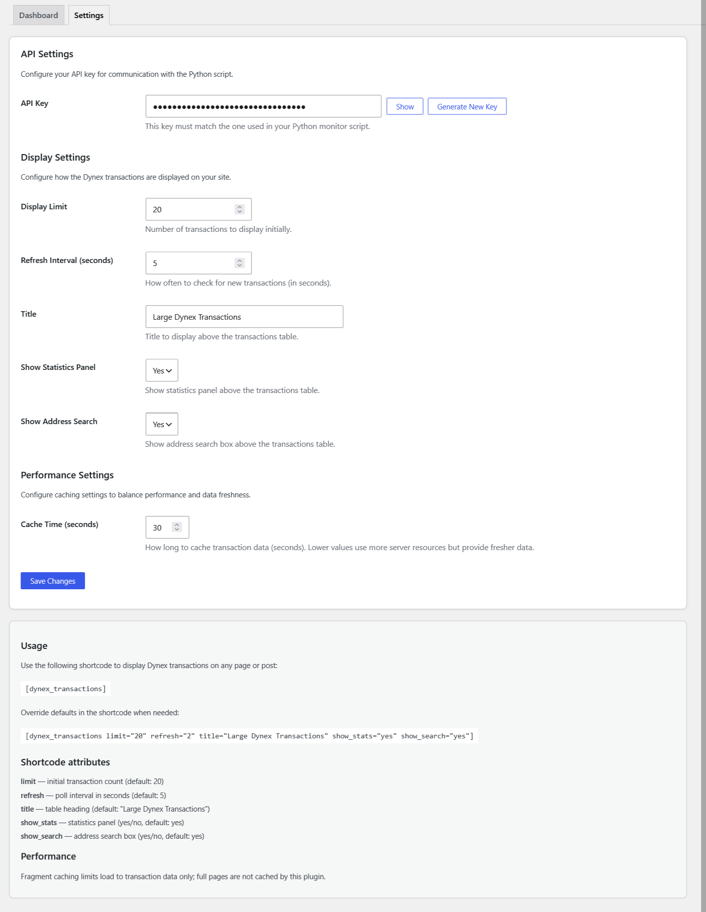

# Dynex Large Transactions

Large transfers can disappear into a busy chain feed. Dynex Large Transactions gives visitors a focused view of those movements, with summary figures, address search and transaction details in a WordPress dashboard.

## Tech stack

| Layer | Technologies |
|---|---|
| Application | PHP, WordPress |
| Supporting technologies | HTML, CSS, JavaScript; Dynex |

## Follow the relevant transfers

The feed keeps large movements together instead of mixing them with unrelated chain activity. Expand entries when more context is needed, or keep the view compact for scanning. Transaction references support further investigation.

## Read the broader context

Summary statistics help place the current feed in perspective. Time and activity information support deciding whether a movement deserves closer attention. The view presents observations without assigning an unsupported explanation to the transfer.

## Search by address

Address search offers a more direct route when the visitor is investigating a particular participant. It narrows the task from scanning a general feed to checking relevant activity. Results remain part of the same dashboard experience.

## Publish and maintain the dashboard

The site owner can embed the view in WordPress and use administrator status and settings areas to maintain it. This keeps the public feed and operational checks within the same product.

---

Private code: [dynex-large-transactions-plugin](https://github.com/logicencoder/dynex-large-transactions-plugin)

See [REPOS.md](REPOS.md) for related repositories.

**[Logic Encoder](https://logicencoder.com)** · [GitHub](https://github.com/logicencoder) · [Contact](https://logicencoder.com/contact/)
